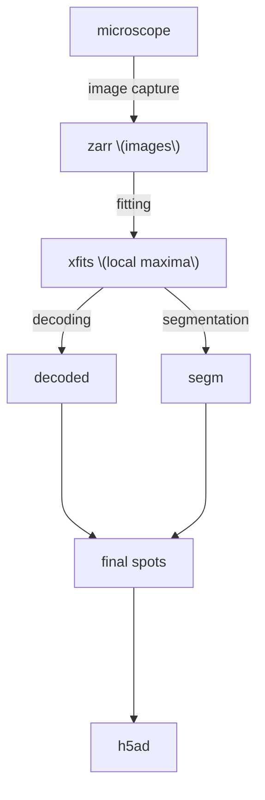

Introduction
------------
MERMAKE processes MERFISH, smFISH, and IF imaging data by detecting local intensity maxima (puncta) in 3D image stacks. In multiplexed experiments (MERFISH), these puncta are decoded using a user-supplied codebook, while in smFISH mode and IF, the puncta are simply called and reported as-is.

## Installation

MERMAKE needs an **NVIDIA GPU** and CuPy. Pick the extra that matches your CUDA version (`cuda12` for CUDA 12.x, `cuda11` for CUDA 11.x). The extras install CuPy together with the CUDA headers it needs to compile kernels (`cupy-cuda12x[ctk]`), so a separate CUDA Toolkit install is not required. `nvcc` is not needed either, since CuPy compiles kernels with NVRTC.

With [uv](https://docs.astral.sh/uv/):
```
uv sync --extra cuda12
uv run mermake settings.toml
```

With pip:
```
python3 -m pip install "mermake[cuda12]"
```

The `cuda11` and `cuda12` extras are mutually exclusive. Add `viz` (`mermake[cuda12,viz]`) for the napari viewer used by `mermake --check`. If CuPy cannot find a GPU, `mermake` stops at startup with an error; see the [CuPy install guide](https://docs.cupy.dev/en/stable/install.html) for driver and CUDA troubleshooting.

## MERMAKE pipe line
the general steps of the MERMAKE merfish pipeline is:
Here is a simple flow chart:



##  MERMAKE Usage

```
mermake settings.toml
```

The settings file is TOML. Only the `[paths]` section is required, and it needs five keys: `psf_file`, `flat_field_tag`, `hyb_folders`, `hyb_range` and `output_folder` (plus the optional `fov_range`). Every other setting has a default, so `[hybs]` and `[dapi]` only list what you want to change. Relative paths are resolved against the folder that holds the settings file.

```toml
[paths]
psf_file = 'psfs/psf_scope3.npy'
flat_field_tag = 'flat_field/Scope3_'
hyb_folders = ['experiment_folder']
hyb_range = 'H1_BICAN_set1:H16_BICAN_set1'
output_folder = 'output'

[hybs]
threshold = 4000   # override one deconvolution/peak-finding setting
```

The settings are checked before the GPU is touched. Misspelled keys, wrong types, out of range values and missing files are all reported at once, for example `[hybs] unknown key 'threshhold', did you mean 'threshold'?`.

| Command | What it does |
|---------|--------------|
| `mermake --print-example` | print a minimal commented settings file to start from |
| `mermake --print-config settings.toml` | print **every** setting with its description, unit and the value that will be used (defaults filled in); needs no GPU |
| `mermake --dry-run settings.toml` | validate and list the images that would be processed; needs no GPU |

`--print-config` is the reference for what each setting means. In short, `patch_size` and `patch_overlap` describe the xy patches the image is cut into for FFT deconvolution (not the raw image size), `beta` and `blur_radius` shape the deconvolution, and `threshold`, `delta`, `delta_fit`, `sigmaZ` and `sigmaXY` control the peak finding. To use multiple PSFs, set `patch_size` to the spacing of the PSF sampling grid (for example 300).

## 🔍 If you only want to process the dapi channels a trick that you can use is
To set the `hyb_save` toml string to not be dynamic and with different names for each fov and hyb.
```
hyb_save =  'Xhfits.npz'
dapi_save = '{fov}--{tag}--dapiFeatures.npz'
```
What this does is trick mermake into thinking the hybs for each fov and channel has already been processed due
to the existing Xhfits.npz file

## Development

```
uv sync --extra cuda12   # runtime plus the dev group (pytest, ruff)
uv run pytest tests/ -v  # tests marked "gpu" skip themselves without cupy or a CUDA device
uv run ruff check
uv build
```

Tests that need a GPU (the kernels, deconvolution, alignment and the end-to-end run in `tests/test_pipeline_e2e.py`) are marked `gpu`. Without a CUDA device they are skipped, so the filename, config and CLI tests run anywhere (`uv sync && uv run pytest`). GitHub Actions runs lint, the CPU tests on Python 3.10 and 3.13, and a wheel build; the full suite has to be run on a GPU machine.

Source layout (`src/mermake/`):

| Module | Contents |
|--------|----------|
| `cli.py`, `__main__.py` | argument parsing, `--print-config`, `--dry-run`, `mermake` entry point |
| `pipeline.py` | the processing loop: dapi, per-channel maxima, drift, save |
| `io/` | `readers` (zarr/flat fields), `naming` (filename parsing, `FolderFilter`), `queue` (`ImageQueue`, `Block`), `metadata` (XML) |
| `gpu/` | CuPy kernels and helpers: `blur`, `fill`, `elementwise`, `fft`, `runtime`, and the `.cu` sources in `kernels/` |
| `deconvolver.py`, `maxima.py`, `align.py` | deconvolution, local-maxima detection, drift and alignment |
| `config.py` | the settings: typed dataclasses with defaults, per-setting docs and validation |
| `points.py`, `viz.py` | point clustering helpers, napari viewer |

## Known issues

Bugs and rough edges found during the package restructuring. Entries are kept until fixed.

| # | Area | Issue | Status |
|---|------|-------|--------|
| 2 | Test fixtures | `tests/examples/single/out/*.npz` do not match the output of the current code (nor of the code before the restructuring), so they are from an older version and cannot be used as a regression reference. | Open. Regenerate them or replace them with a small fixture. |
| 3 | Test data size | `tests/examples/` is about 287 MB tracked in git. | Open. Plan: a small fixture in git, the full data as a Code Ocean data asset. |
| 4 | Tests | `test_with_mocked_blur` in `tests/test_deconvolver.py` is never collected, so it does not run. | Open. |
| 6 | Linting | `ruff check` reported 26 findings under the configured rule set (E4, E7, E9, F), including unused variables and a bare `except`. | Fixed in `30f6cb9`. CI now enforces it. |
| 7 | Maxima kernels | Neighbor lookups in `local_maxima_count` and `local_maxima` read out of bounds when `delta` is larger than an image dimension, which crashed the test suite with `cudaErrorIllegalAddress`. Real images are far larger than `delta`, so normal runs were not affected. | Fixed in `5bd0737`. |
| 8 | Point helpers | `points.estimate_step_size` raised `NameError` because `KDTree` was never imported. Nothing calls it. | Fixed in the `io`/`utils` split. |
| 9 | Compare script | `scripts/compare_xh.py` used undefined `ref_data`/`temp_data` in its `Xh_minus` check. | Fixed in the `__main__` split. |
| 10 | Deconvolution | Reported positions are shifted by +1 voxel along any axis whose padded length is odd. `Deconvolver` rolls the padded PSF by `-N // 2`, which is one voxel too far when `N` is odd. For z, `N = 2 * zpad + depth`, so every odd z depth (for example 35 planes per channel) gives z coordinates that are +1. x and y are not affected with the default even `patch_size` and `patch_overlap`. A constant shift does not hurt decoding, but it matters when comparing to other data. Found by `tests/test_pipeline_e2e.py`. | Open. Fixing it changes output coordinates. |
| 11 | Dead code | `config.count_colors` globs for `*<name>.zarr.xml` but the metadata file is `<name>.xml`, so it would fail with `IndexError`. `Config`, `count_bits`, `count_colors` and `count_hybs` are not called anywhere. `points.find_two_means` is also unused and fits 3 clusters although its name says two. | Open. Remove or fix. |
