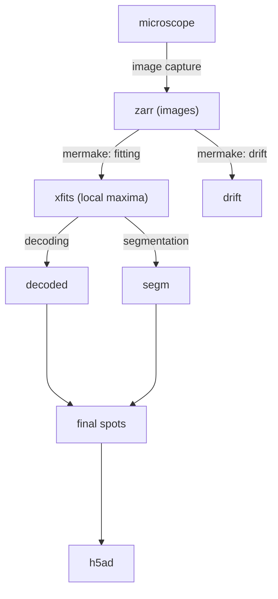
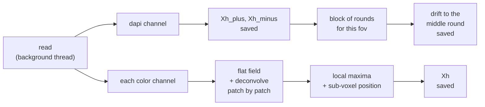

# Pipeline overview

## Where MERMAKE fits

MERMAKE covers the first two arrows: from the images to the maxima (called *xfits* in the file names) and the drift. Decoding and the later steps happen downstream.

## What happens to an image

An *image* is one field of view in one hybridization round, with all its color channels. The last channel is always dapi.

1. **Read.** An [`ImageQueue`][mermake.io.queue.ImageQueue] finds the images that match `hyb_folders`, `hyb_range` and `fov_range`, and reads them ahead in a background thread. Channels whose result file already exists are loaded from it instead of being read and processed again.
2. **Dapi.** The dapi channel is divided by the flat field and deconvolved with the `[dapi]` settings. The result is divided by its standard deviation, so `[dapi] threshold` is in units of standard deviations. Maxima are found in the image (`Xh_plus`) and in the negated image (`Xh_minus`), and both are saved.
3. **Color channels.** Each one is divided by its flat field and deconvolved with the `[hybs]` settings, one xy patch at a time: the image is cut into square patches of `patch_size` pixels with `patch_overlap` pixels of extra context, and each patch is FFT-deconvolved over the full z range. The xy box blur of `blur_radius` is subtracted, then local maxima are found. Each position is refined to the intensity-weighted centroid of its neighborhood (radius `delta_fit`), and two correlation scores against a Gaussian template are computed (`sigmaZ`, `sigmaXY`). Maxima within `patch_overlap` of the edge of a patch are dropped, because the neighboring patch sees them with full context. The rest are moved to full-image coordinates and saved as `Xh`.
4. **Drift.** The images of one field of view from all rounds are collected into a block. When the next image belongs to another field of view (or the data ends), the dapi maxima of every round are aligned to those of the middle round, which gives the drift of each round in z, x and y. It is saved once per field of view and set. See [`Aligner`][mermake.align.Aligner].

Saving happens in a thread pool, in parallel with the next image.

## Resuming

Every result file is written only if it does not exist, and existing files are loaded instead of recomputed. A run that was interrupted continues where it stopped, and a finished run does nothing. To recompute something, delete its file.
